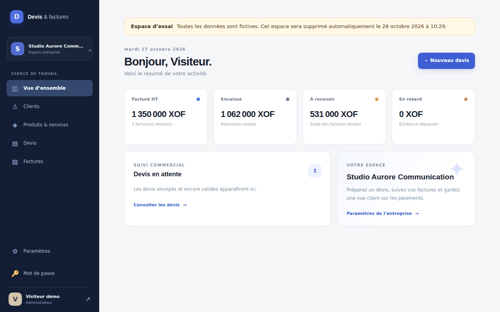
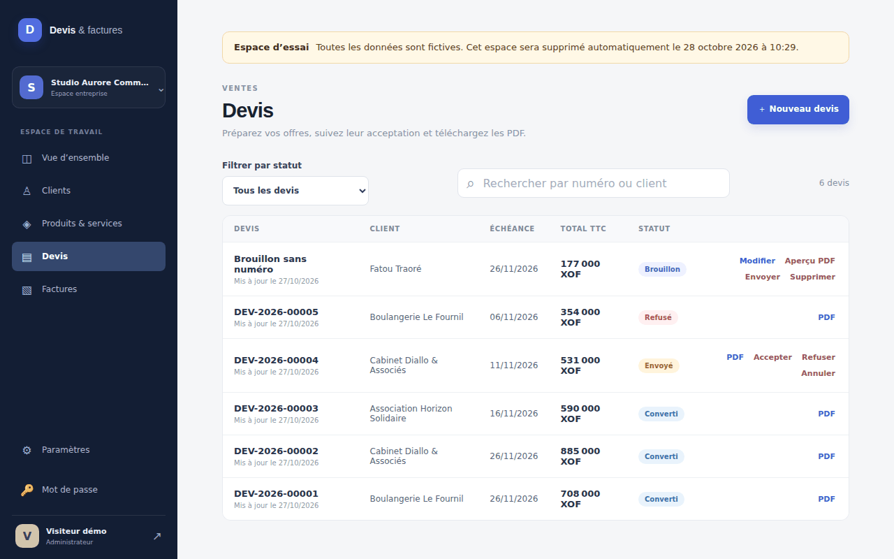
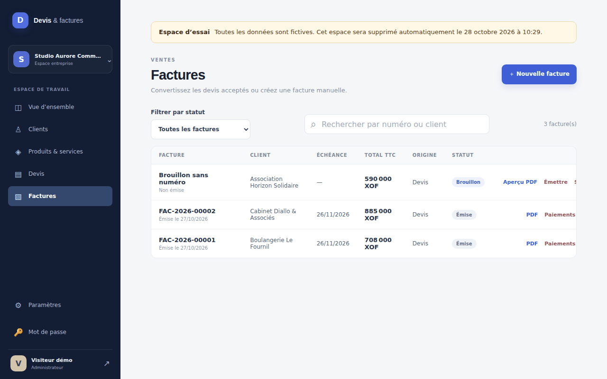
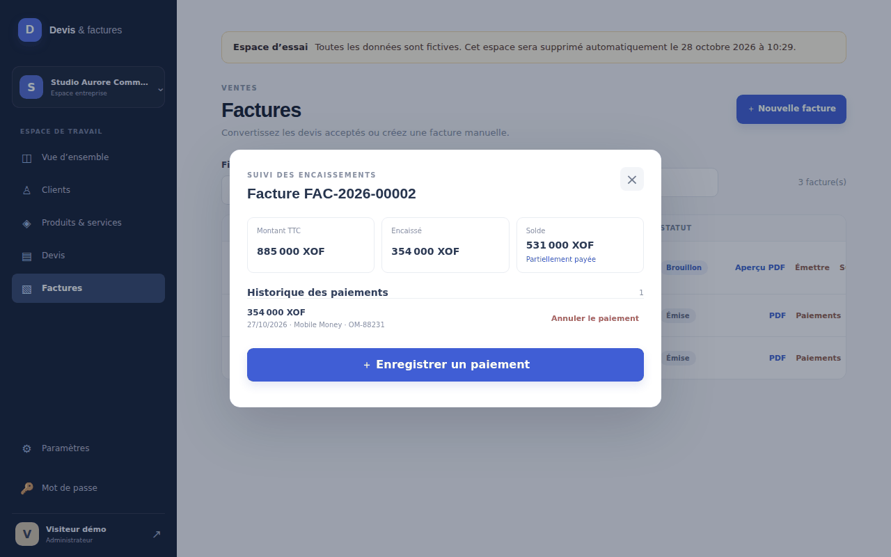
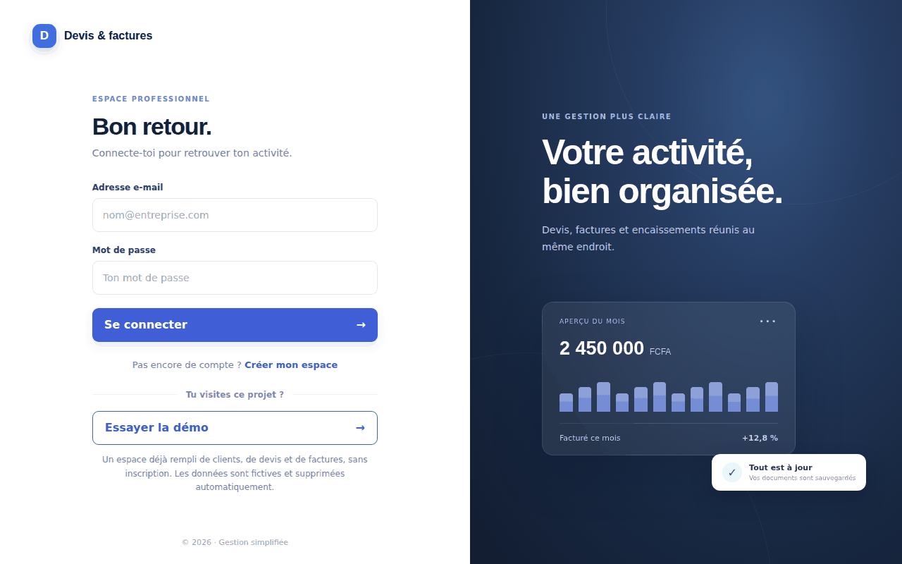
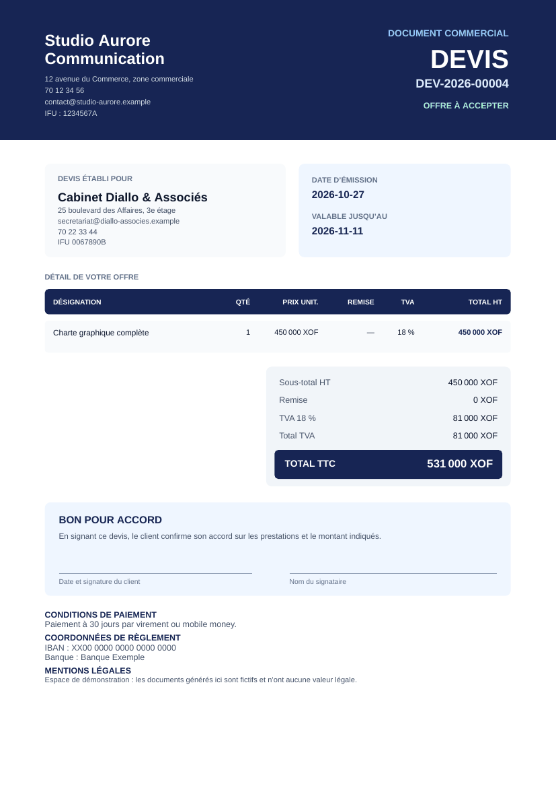
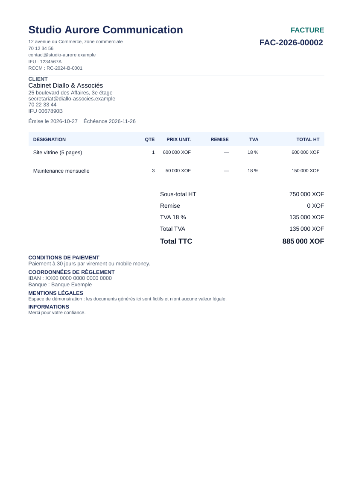
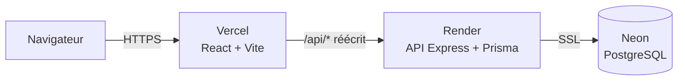

# Générateur de devis et factures

Application web pour créer des devis, les transformer en factures numérotées, suivre les paiements et produire des **PDF figés**. Elle gère plusieurs entreprises isolées les unes des autres, et les montants sont en **F CFA (XOF)** par défaut.

**▶ Démo en ligne : [generateur-devis-facture.vercel.app](https://generateur-devis-facture.vercel.app/login)**

Sur la page de connexion, cliquez sur **« Essayer la démo »** : aucun compte n'est nécessaire. Vous obtenez votre propre espace, déjà rempli de clients, de devis dans chaque état, de factures et de paiements. Vous pouvez tout y faire : créer un devis, l'envoyer, le convertir en facture, enregistrer un paiement, télécharger les PDF. Les données sont fictives et votre espace est supprimé automatiquement au bout de 12 heures.

> L'API est hébergée sur un plan gratuit qui s'endort après 15 minutes d'inactivité. Le premier chargement peut prendre **jusqu'à une minute** : le bouton apparaît dès que le serveur est réveillé.



## Aperçu

| | |
|---|---|
|  |  |
| **Devis** : un état par ligne (brouillon, envoyé, refusé, converti) et les actions possibles | **Factures** : brouillon, émise, avec accès au PDF et aux paiements |
|  |  |
| **Paiements** : acompte, solde restant et historique | **Connexion** : un clic pour ouvrir un espace d'essai |

Les PDF sont générés par le serveur, sans navigateur. Ceux-ci viennent de l'espace de démonstration :

| | |
|---|---|
|  |  |
| **Devis** avec bon pour accord et conditions de règlement | **Facture** émise, avec échéance et totaux |

## Fonctionnalités

- **Clients et catalogue** de produits et services, avec TVA par ligne.
- **Devis** : brouillon, envoi numéroté (`DEV-AAAA-NNNNN`), acceptation, refus, annulation et conversion en facture. L'expiration est calculée à partir de la date de validité.
- **Factures** : créées depuis un devis accepté ou à la main, puis émises avec un numéro annuel (`FAC-AAAA-NNNNN`) et une échéance calculée. Une facture sans paiement peut être annulée, avec un PDF d'annulation.
- **Paiements** : plusieurs paiements par facture (virement, espèces, chèque, mobile money, carte, autre). Le solde et l'état (payée, partiellement payée, en retard, impayée) sont calculés à la lecture. Un paiement n'est jamais supprimé, seulement annulé avec un motif.
- **PDF** : générés à l'envoi ou à l'émission depuis un instantané figé du document.
- **Tableau de bord** : facturé hors taxes, encaissé, à recevoir, en retard et devis en attente.
- **Paramètres de l'entreprise** : identité, identifiants fiscaux, logo (PNG ou JPEG jusqu'à 2 Mo), devise, TVA par défaut, préfixes de numérotation, délai de paiement, coordonnées de règlement et mentions légales.
- **Comptes** : l'inscription crée l'entreprise et son administrateur ; changement de mot de passe depuis l'application.

## Choix techniques

- **Calculs monétaires exacts.** Les montants sont des `bigint` dans la plus petite unité de la devise, les quantités sont des milli-unités et les taux des points de base. Aucun nombre flottant n'intervient dans un calcul métier, et des tests de propriétés (`fast-check`) vérifient que les totaux, remises et taxes restent cohérents quelles que soient les lignes saisies.
- **Documents immuables.** À l'envoi d'un devis ou à l'émission d'une facture, un instantané complet du document (entreprise, client, lignes, totaux, mentions) est figé avec son empreinte SHA-256. Des déclencheurs PostgreSQL empêchent ensuite de modifier ses champs métier. Un PDF manquant peut être régénéré à l'identique depuis l'instantané : à la consultation pour un devis, et avec `npm run docs:reconcile-pdf` pour tous les documents.
- **Numérotation annuelle sans trou**, y compris avec des demandes simultanées (testé).
- **Concurrence optimiste et idempotence.** Les modifications exigent un en-tête `If-Match` portant la version du document. L'enregistrement d'un paiement exige un en-tête `Idempotency-Key`, valable 24 heures.
- **Isolation entre entreprises.** Chaque requête est limitée à l'entreprise de l'utilisateur. Une transition sur le document d'une autre entreprise reçoit la même réponse qu'une transition interdite, pour ne jamais révéler qu'il existe. Des tests croisés le vérifient.
- **Sécurité.** Cookies de session `HttpOnly`, `Secure` et `SameSite`, protection CSRF par double soumission, jetons de rafraîchissement à rotation avec détection de réutilisation, verrouillage après 5 échecs de connexion en 15 minutes, mots de passe hachés avec bcrypt, en-têtes de sécurité (`Content-Security-Policy`, `Strict-Transport-Security`, `X-Frame-Options`…) et journal d'audit.
- **PDF sans navigateur.** Génération avec `pdfkit` et polices embarquées : le rendu est déterministe, sans dépendance à Chromium.
- **Espaces d'essai.** Le bouton de démonstration crée une entreprise isolée en passant par l'API du serveur lui-même, donc par la même logique que la production. Quelques espaces complets sont préparés d'avance pour que le clic soit instantané, même sur un processeur lent. Des limites par adresse IP et un plafond d'espaces actifs empêchent l'abus, et seules les entreprises marquées comme espaces d'essai peuvent être purgées.
- **Hébergement gratuit.** Le disque de l'hébergeur étant éphémère, les PDF et les logos peuvent être conservés dans PostgreSQL (`DOCUMENTS_STORAGE=database`).

## Architecture



Le navigateur ne parle qu'à un seul domaine : les cookies de session et la protection CSRF fonctionnent donc sans configuration CORS.

| Couche | Technologies |
|---|---|
| Frontend | React 19, TypeScript, Vite, React Router, React Hook Form, Zod |
| Backend | Node.js 22, Express 5, Prisma 6, `pdfkit`, `sharp`, `jsonwebtoken`, `bcryptjs` |
| Base de données | PostgreSQL 16, migrations versionnées, déclencheurs d'immuabilité |
| Tests et qualité | Vitest, `fast-check`, Playwright, ESLint |
| CI et déploiement | GitHub Actions ; Vercel, Render et Neon |

## Démarrage en local

**Prérequis** : Node.js 22 et Docker (pour PostgreSQL).

```bash
git clone https://github.com/XAlbert07/generateur-devis-facture.git
cd generateur-devis-facture
npm install
cp .env.example .env        # puis remplacez JWT_SECRET par une valeur aléatoire d'au moins 32 caractères
docker compose up -d database
npm run db:generate
npm run db:migrate
npm run dev:api             # API sur http://localhost:3000
```

Dans un second terminal :

```bash
npm run dev:web             # application sur http://localhost:5173
```

Créez ensuite votre premier compte depuis `http://localhost:5173/register` avec **Créer mon espace**. Aucun identifiant n'est précréé.

**Démo en local (facultatif).** Dans `.env`, ajoutez `SANDBOX_ENABLED=true` : le bouton « Essayer la démo » apparaît sur la page de connexion.

## Variables d'environnement

| Variable | Rôle | Défaut |
|---|---|---|
| `DATABASE_URL` | Connexion PostgreSQL | requis |
| `JWT_SECRET` | Secret de signature des sessions (32 caractères minimum) | requis |
| `PORT` | Port de l'API | `3000` |
| `NODE_ENV` | `production` active les cookies `Secure` et HSTS | |
| `CORS_ORIGIN` | Origines autorisées en CORS. Vide : pas de CORS | vide |
| `DOCUMENTS_STORAGE` | `filesystem` ou `database` pour les PDF et les logos | `filesystem` |
| `DOCUMENTS_DIR` | Répertoire des documents en mode `filesystem` | `var/documents` |
| `SANDBOX_ENABLED` | Active le bouton « Essayer la démo » | `false` |
| `SANDBOX_TTL_HOURS` | Durée de vie d'un espace d'essai, en heures | `12` |
| `SANDBOX_MAX_ACTIVE` | Nombre maximal d'espaces d'essai simultanés | `30` |
| `SANDBOX_MAX_PER_IP_PER_HOUR` | Espaces créés par adresse IP et par heure | `3` |
| `SANDBOX_POOL_SIZE` | Espaces complets préparés d'avance (0 : désactivé) | `2` |

## Commandes utiles

| Commande | Effet |
|---|---|
| `npm run dev:api` / `npm run dev:web` | API et application en développement |
| `npm run typecheck` / `npm run typecheck:web` | Vérification des types, backend et frontend |
| `npm run lint` | ESLint |
| `npm test` | Tests unitaires et de propriétés |
| `npm run test:integration` | Tests d'intégration PostgreSQL (base dont le nom se termine par `_test`) |
| `npm run test:e2e` | Parcours complet avec Playwright |
| `npm run audit:deps` | Audit des dépendances, avec exceptions documentées |
| `npm run sandbox:purge` | Supprime les espaces d'essai expirés (`-- --all` : tous) |
| `npm run auth:reset-password` | Réinitialise le mot de passe d'un utilisateur |
| `npm run docs:reconcile-pdf` | Vérifie la cohérence des PDF et de leurs empreintes |
| `npm run ops:restore-drill` | Teste la restauration d'une sauvegarde |

## Tests et intégration continue

Le projet compte environ 80 tests automatisés : tests unitaires et de propriétés, tests d'intégration sur un vrai PostgreSQL (cycle complet devis, facture et paiements, isolation entre entreprises, numérotation concurrente, espaces d'essai) et un parcours de bout en bout avec Playwright.

À chaque push, GitHub Actions lance un PostgreSQL 16, puis exécute : installation propre (`npm ci`), audit des dépendances, génération Prisma, migrations, vérification des types du backend et du frontend, tests unitaires et tests d'intégration.

## Déploiement

Le projet est déployé gratuitement sur trois services. Chaque `git push` sur `master` redéploie automatiquement.

- **Neon** héberge PostgreSQL. Utilisez l'adresse de connexion **directe** (sans `-pooler`), car les migrations Prisma l'exigent.
- **Render** exécute l'API (`render.yaml`). La commande `npm run start:render` applique les migrations puis démarre le serveur. La variable `DATABASE_URL` se saisit dans le tableau de bord de Render.
- **Vercel** sert le frontend (`vercel.json`) et redirige `/api/*` vers l'API.

Pour un serveur unique avec Caddy et TLS, voir [`deploy/README.md`](deploy/README.md).

## Documentation

- [Conception du projet](conception/Conception%20du%20projet%20%E2%80%94%20G%C3%A9n%C3%A9rateur%20de%20devis%20et%20factures%20%28v2.0%29.md) : spécification fonctionnelle et technique.
- [État du backend et de la base](conception/ETAT_BACKEND_BASE_DE_DONNEES.md) et [comparaison avec la conception](conception/COMPARAISON_CONCEPTION_V2_IMPLEMENTATION.md).
- [Plan jusqu'à la production](conception/PLAN_RESTE_MVP_PRODUCTION.md) et [runbook d'exploitation](conception/RUNBOOK.md).
- [Checklist légale](conception/CHECKLIST_LEGAL_%C2%A717.md) : points à vérifier avant un usage réel.

## Limites connues

- **Démarrage à froid.** Sur les plans gratuits, l'API met environ 50 secondes à se réveiller, et la base Neon environ 1 à 2 secondes après une pause.
- **Un seul rôle appliqué.** Les rôles Gestionnaire, Comptable et Lecteur existent dans le modèle de données, mais seul l'administrateur est distingué (pour les paramètres de l'entreprise).
- **Pas de collaborateurs.** Un compte correspond à l'entreprise créée à l'inscription, sans invitation d'autres utilisateurs.
- **Pas d'envoi par e-mail.** Passer un devis à « envoyé » le numérote et le fige, mais aucun message n'est expédié.
- **Pas de conformité légale garantie.** Les mentions et la numérotation suivent une checklist documentée, mais ne remplacent pas la vérification des règles du pays d'usage.

## Auteur

Projet personnel réalisé par [@XAlbert07](https://github.com/XAlbert07).
